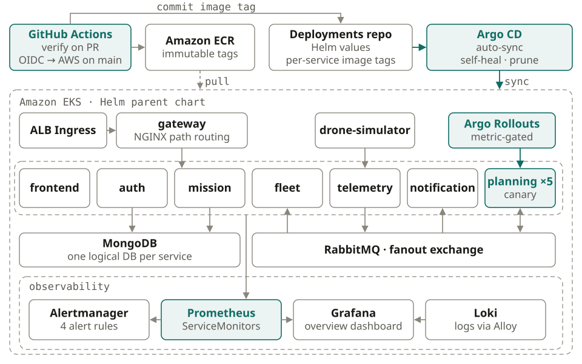

# SwarmOps

Drone fleet mission planning with real-time dynamic re-planning, running as nine services on AWS EKS and delivered through GitOps.

> **This is the only public SwarmOps repository.** The source code is private. **Want to see it running? [Contact us for a live demo](#contact).**

## What it does

Given drones with limited battery and a list of missions, SwarmOps assigns drones to missions, computes routes the battery can actually fly, avoids no-fly zones, adds charging stops, and re-plans when conditions change. Everything is shown on a live operator map. The drone fleet is simulated.

## How it runs

- **Nine services** on AWS EKS: frontend, NGINX gateway, auth, fleet, missions, planning, telemetry, notifications and a drone simulator, with MongoDB and RabbitMQ in the cluster.
- **Event-driven planning.** Telemetry goes through RabbitMQ. The planning service re-solves on low-battery and mission-complete events, backed by a 30-second reconcile loop and a TTL solve lock so only one of its five replicas solves at a time.
- **GitOps delivery.** GitHub Actions authenticates to AWS through OIDC (no static keys), builds immutable image tags, pushes to ECR and bumps the image tag in a deployments repository. Argo CD syncs one parent Helm chart to the cluster with auto-sync, self-heal and prune.
- **Safe releases.** The planning service ships through an Argo Rollouts canary (20%, 50%, 100%) gated on Prometheus analysis of 5xx rate and p95/p99 latency.
- **Infrastructure as code.** Terraform provisions the VPC, EKS on Spot nodes, ECR with immutable tags and scan on push, and the CI role. State is split so the cluster can be destroyed between sessions without losing the registry or CI access.
- **Observability.** Prometheus metrics and structured JSON logs on every backend service, Grafana dashboards, Loki for logs, and alert rules.

## Stack

AWS EKS · Terraform · Argo CD · Argo Rollouts · Helm · GitHub Actions · Prometheus · Grafana · Loki · MongoDB · RabbitMQ · React

## Verified results

- 9 services healthy on EKS in live verification.
- 9 service pipelines publishing through OIDC, with 87 automated image bumps in the deployments repository.
- In a canary rehearsal with injected faults, the Prometheus analysis measured about 35% errors on the canary and aborted the rollout while the 5 stable pods kept serving.

## Contact

Interested in a live demo, or in talking about the platform? Get in touch:

- Email: [toni7891@gmail.com](mailto:toni7891@gmail.com)
- LinkedIn: [linkedin.com/in/tony-verin](https://linkedin.com/in/tony-verin)
